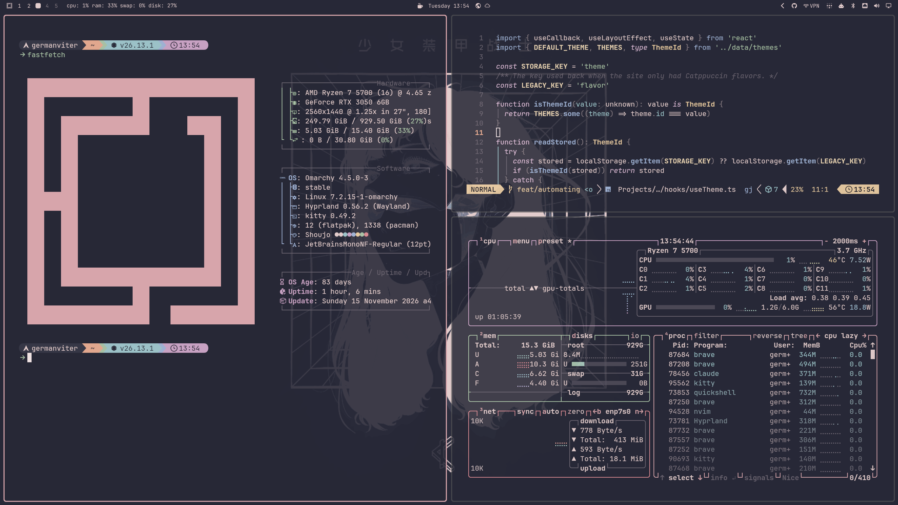
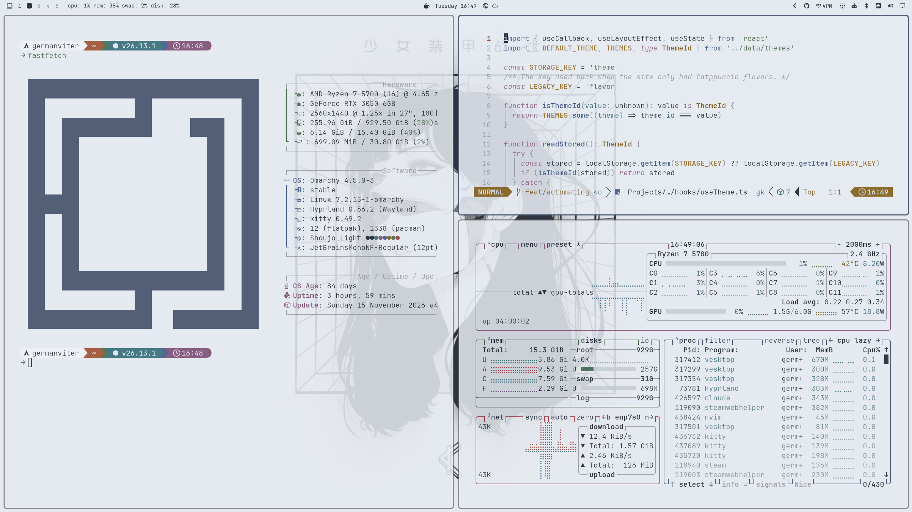
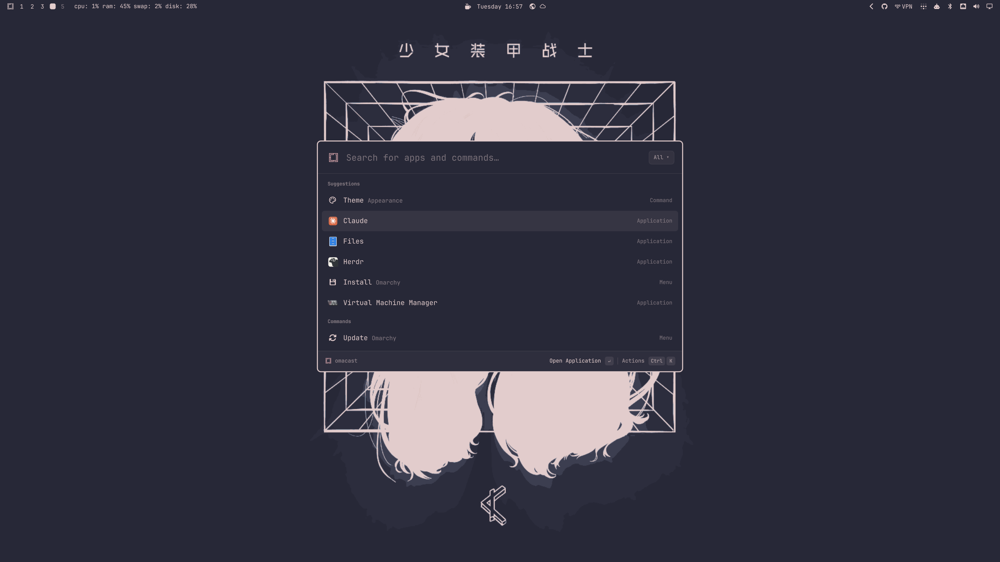
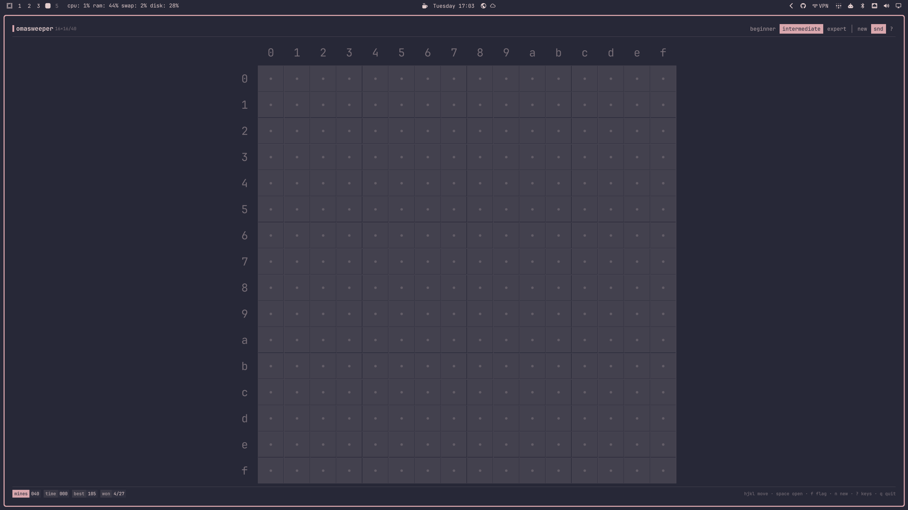
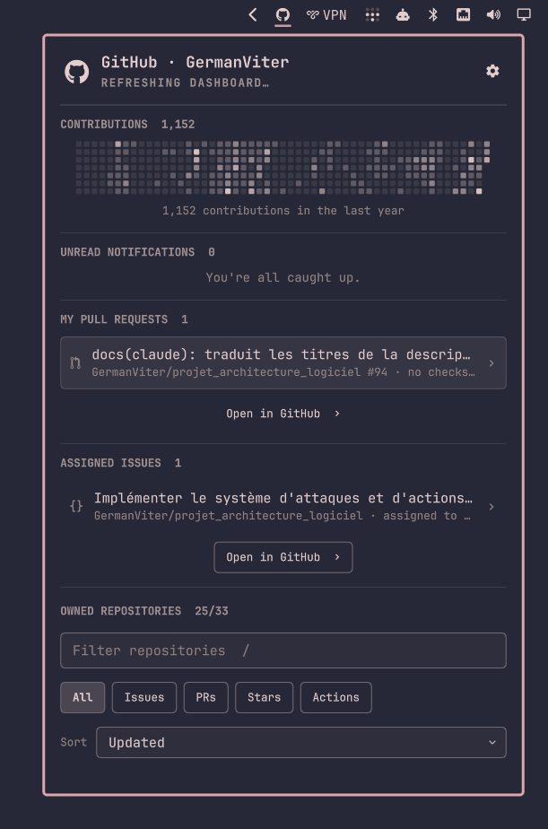
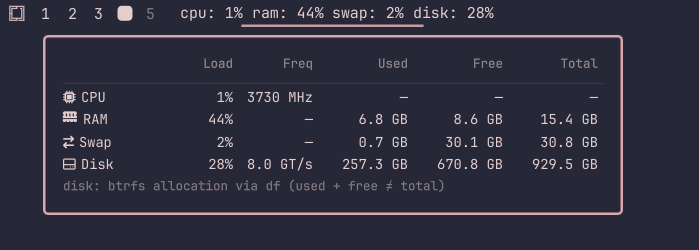
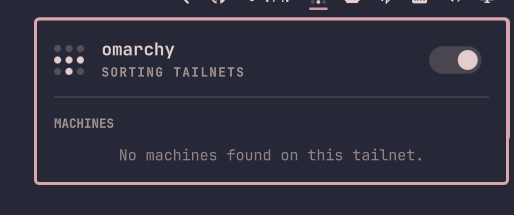

# Dotfiles

Personal configuration files and environment settings for Linux. 

## Contents
- [Overview](#overview)
- [Themes](#themes)
- [Plugins](#plugins)
- [Managed Applications](#managed-applications)
- [Dependencies](#dependencies)
- [Installation](#installation)
- [Script Options](#script-options)
- [How it Works](#how-it-works)
- [Omarchy Plugins](#omarchy-plugins)
- [Troubleshooting](#troubleshooting)
- [Adding New Configs](#adding-new-configs)

## Overview

This repository uses a modular structure where each directory represents an application or tool. A central setup script manages the creation of symbolic links from the repository to your home directory and `~/.config` folder on [Omarchy](https://omarchy.org/).

## Themes

| shoujo-dark | shoujo-light |
| :---: | :---: |
|  |  |

> [!TIP]
> Checkout my wallpapers on [GermanViter/wallpapers](https://github.com/GermanViter/wallpapers).

## Plugins

The Omarchy plugins I use. See [Omarchy Plugins](#omarchy-plugins) for how they get installed.

<table>
  <tr>
    <th><a href="https://github.com/typecraft-dev/oma-cast">Omacast</a></th>
    <th><a href="https://github.com/jankeesvw/omasweeper">Omasweeper</a></th>
  </tr>
  <tr>
    <td align="center"></td>
    <td align="center"></td>
  </tr>
  <tr>
    <th><a href="https://github.com/robzolkos/omarchy-github">GitHub</a></th>
    <th><a href="https://github.com/tslove923/omarchy-system-monitor">System Monitor</a></th>
  </tr>
  <tr>
    <td align="center" rowspan="3"></td>
    <td align="center"></td>
  </tr>
  <tr>
    <th>Tailscale</th>
  </tr>
  <tr>
    <td align="center"></td>
  </tr>
</table>

## Managed Applications

- **Terminal/Shell**: [Zsh](https://www.zsh.org/)
- **Editors**: [Neovim](https://neovim.io/) (LazyVim)
- **Prompt**: [Starship](https://starship.rs/)
- **UI/Window Management**: [Kitty](https://sw.kovidgoyal.net/kitty/), Hyprland keybindings
- **CLI Tools**: [Fastfetch](https://github.com/fastfetch-cli/fastfetch), [Bat](https://github.com/sharkdp/bat) 

## Local Overrides

To add private configurations (like work-specific paths or API keys) without committing them to the repository, use local override files:
- **Zsh**: Create `~/.zshrc.local`

These files are ignored by Git.

## Dependencies
The unified install script is designed specifically for Omarchy and automatically manages dependencies through `omarchy pkg add`:
- **Core Dependencies**: `stow`, `fzf`, `eza`, `bat`, `zoxide`, `starship`, `fastfetch`
- **Extended Tools** (with `--all`): `neovim`, `kitty`, `tmux`, `git`, `zsh`

## Installation

To apply these configurations to a new system:

1. **Clone the repository on Omarchy:**
   ```bash
   git clone https://github.com/GermanViter/omarchy_dots.git ~/.dotfiles
   cd ~/.dotfiles
   ```

2. **Run the installer:**
   The unified `scripts/install.sh` script installs core dependencies via `omarchy pkg add` and creates symlinks using [GNU Stow](https://www.gnu.org/software/stow/):
   ```bash
   ./scripts/install.sh
   ```

### Script Options

- `(no arguments)`: Installs core dependencies, creates symlinks, sets up Zsh with Oh My Zsh, and offers the external Omarchy plugins.
- `-n, --dry-run`: Simulates the process without making any changes.
- `--no-change-shell`: Sets up dotfiles and Oh My Zsh without changing the default login shell.
- `-d, --deps-only`: Installs dependencies and Zsh setup only (skips symlinking).
- `-s, --symlinks-only`: Creates symlinks only (skips dependency and Zsh setup).
- `-u, --unlink`: Removes the symlinks (unstow).
- `-a, --adopt`: Adopts existing target files into the repository during stowing.
- `--all`: Installs full suite of tools (including Neovim, Kitty, Tmux).
- `-p, --plugins-only`: Only offers the external Omarchy plugins.
- `--no-plugins`: Skips the Omarchy plugin prompts.
- `-c, --check`: Inspects status of dependencies, default shell, Oh My Zsh, and available stow packages.
- `-h, --help`: Displays help information.

## How it Works

The `scripts/install.sh` script is a wrapper around `stow` and `omarchy pkg`:

1. **Modular Packages**: Package directories (e.g., `zsh`, `kitty`, `fastfetch`, `starship`, and `hypr`) are automatically detected and treated as "stow packages".
2. **Mirroring**: Stow mirrors the internal structure of these directories into your `$HOME`.
   - `zsh/.zshrc` becomes `~/.zshrc`
   - `kitty/.config/kitty/` becomes `~/.config/kitty/`
3. **Safety**: Stow will not overwrite existing real files by default. It only creates symlinks. If a file already exists, it will report a conflict unless `--adopt` is provided.

## Omarchy Plugins

Third-party Omarchy shell plugins are listed in `scripts/omarchy-plugins.txt`, one `<plugin-id> <git-url>` per line. Plugins that ship with Omarchy are not listed.

- **Installing**: `scripts/install.sh` asks about each listed plugin that is not installed yet, then whether to enable it. Answering no skips that plugin and the script carries on. `--plugins-only` runs just this step and `--no-plugins` skips it.
- **Adding**: run `omarchy plugin add <git-url>` as usual. The wrapper in `zsh/.zshrc.d/96-omarchy-plugins.zsh` then runs `scripts/sync-omarchy-plugins.sh`, which appends the new plugin to the list, commits that one file and pushes it.
- **Catching up**: run `scripts/sync-omarchy-plugins.sh` by hand to record plugins added another way, such as the Omarchy menu. Use `--no-push` or `--no-commit` to hold back.

The list only grows on its own. To stop offering a plugin, delete its line.

## Updating configurations
To update your configurations after pulling new changes from the repository:
1. Pull the latest changes:
   ```bash
   git pull
   ```
2. Re-run the install script to apply any new symlinks:
   ```bash
   ~/.dotfiles/scripts/install.sh
   ```

## Troubleshooting
- If you can't run the script, ensure it has execute permissions:
  ```bash
  chmod +x ~/.dotfiles/scripts/install.sh
  ```
- If you encounter conflicts with existing configuration files, use `--adopt` to import them into the repository:
  ```bash
  ./scripts/install.sh --adopt
  ```
- For any application-specific issues, refer to the respective application's documentation or open an issue in this repository.

## Adding New Configs

To add a new application to this repo:
1. **Create a folder** named after the application (e.g., `fastfetch`). 
   - *Note: Avoid reserved names like `scripts`, `assets`, or `gemini` as the script is configured to ignore them.*
   - *Note: Do not start the folder name with a dot (use `zsh/`, not `.zsh/`).*
2. **Mirror the destination structure** inside that folder:
   - If the config belongs in `~/.config/app/config`, create `app/.config/app/config`.
   - If the config belongs in `~/.apprc`, create `app/.apprc`.
3. **Run the install script** to apply the changes:
   ```bash
   ./scripts/install.sh
   ```
